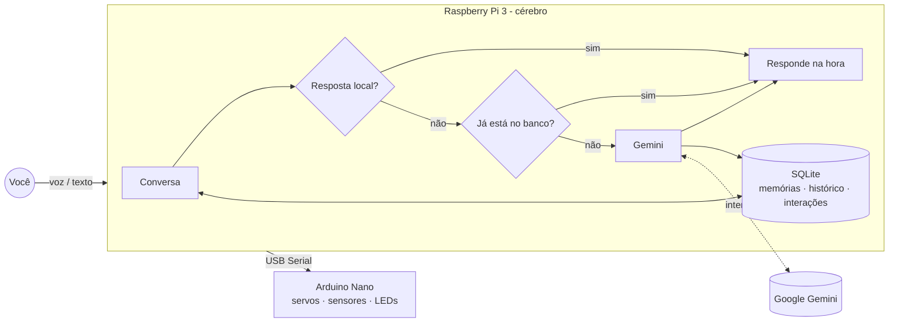

<div align="center">

# 🤖 NEXO

**Um robô companheiro de ombro, inteligente e com memória própria.**


</div>

---

## 📖 Sobre

O **NEXO** não é só um chatbot: é um pequeno robô físico (12 a 15 cm), impresso em 3D, feito para ficar apoiado no ombro e funcionar como um companheiro.

A ideia é que ele consiga:

- 🗣️ **Conversar** por voz e por texto, de forma natural e com contexto
- 🧠 **Lembrar** de conversas anteriores e aprender o que for ensinado
- 👀 **Reconhecer pessoas** cadastradas (com consentimento), localmente
- 🙂 **Expressar emoções** com olhos em display OLED e cabeça móvel
- 📡 **Perceber o ambiente** com sensores
- 🔌 **Funcionar sozinho**, sem depender de um computador

A inteligência pesada roda na nuvem (Google Gemini, dentro da cota gratuita). Memória, visão e controle do corpo ficam **dentro do robô**.

---

## 🏗️ Arquitetura



| Parte | Responsabilidade |
|---|---|
| **Raspberry Pi 3** | Sistema, Python, IA, memória, áudio, visão e comportamento |
| **Arduino Nano** | Servomotores, sensores e LEDs (comandos via USB Serial) |
| **Google Gemini** | Raciocínio e conversa (nuvem, cota gratuita) |
| **SQLite** | Memória de longo prazo, histórico e registro de interações (local) |
| **OpenCV** | Reconhecimento facial local (as imagens não saem do robô) |

---

## ✨ O que já funciona

### 💬 Conversa com IA e contexto
O NEXO conversa por texto usando o Gemini, levando junto a personalidade dele, tudo o que lembra e as últimas 20 mensagens.

### 📝 Resumo das conversas antigas
Mensagens que saem do histórico recente viram um resumo curto (a cada 20 mensagens), que acompanha as próximas conversas. O NEXO lembra do que foi falado dias atrás sem mandar a conversa inteira para a IA.

### 🧠 Memória automática
A cada resposta, a própria IA indica se surgiu um fato novo que vale guardar (seu nome, gostos, rotina...). O NEXO grava sozinho, sem duplicar.

Para não pesar quando a memória crescer, só vão para a IA as lembranças que importam. Até 25, vão todas. Depois disso vão as **essenciais** (nome, como quer ser chamado), as que têm palavras em comum com a conversa (*"moto"* puxa *"gosta de motocicletas"*) e as mais recentes.

### ⚡ Cache inteligente de respostas
Para gastar menos cota e responder mais rápido, cada mensagem segue esta ordem:

1. **Resposta local**: hora, data, dia da semana, ontem, amanhã, contas (*"quanto é 15 vezes 3"*, *"20+14?"*), cumprimentos, agradecimentos e ajuda, sem internet.
2. **Banco**: se a mesma pergunta já foi respondida e é atemporal, devolve do banco.
3. **IA**: só chama o Gemini se não achou nada.

A própria IA marca se a resposta pode ser reaproveitada: *"qual a capital da Austrália?"* pode, *"tudo bem?"* não. E o código tem travas que valem mesmo se a IA errar: piadas, respostas tristes, perguntas de uma palavra só (*"memória"*) e contas em que a ordem importa (*"10-2"*) nunca vão para o cache. Símbolos de conta viram palavra na chave, então *"1+2"* e *"1-2"* nunca se misturam.

| Origem | Tempo médio |
|---|---|
| 🏠 Resposta local | ~0,1 s |
| 💾 Banco (cache) | ~0,1 s |
| ☁️ Gemini | 1,5 a 13 s |

### 🧩 Aprende o seu jeito de perguntar
Para achar a pergunta no banco, o NEXO tira as palavras que não mudam o sentido e monta uma chave:

```text
"Qual a capital do Japão?"                →  capital japao qual
"nexo, qual é mesmo a capital do japão?"  →  capital japao qual   ← acha no banco
```

Abreviações de digitação viram a palavra inteira antes: *"pq"*, *"q"*, *"n"*, *"vc"*, *"tbm"*, *"qntos"*, *"kg"*... Então *"pq o céu é azul"* acha a mesma resposta de *"por que o céu é azul?"*.

Além da lista fixa, ele **aprende sozinho**: na mesma chamada da resposta, a IA aponta as palavras de enfeite da pergunta (*"mesmo"*, *"tipo"*, *"aí"*). Cada sugestão é um voto, e a palavra só passa a ser ignorada com **3 votos de perguntas diferentes** (repetir a mesma pergunta não conta). Quando isso acontece, as chaves antigas são refeitas.

Para não estragar o cache, há proteções:
- A palavra precisa estar na pergunta. A IA não consegue inventar palavras.
- Negações, palavras de pergunta, de tempo e de comparação (*não, quem, onde, ontem, maior...*) nunca são ignoradas.
- Se a IA quiser apagar mais da metade da pergunta, a sugestão é descartada.
- **Teste de colisão:** antes de ativar, o NEXO simula ignorar a palavra no cache real. Se duas perguntas com respostas de sentido diferente passariam a ser a mesma (*"**ainda** chove?"* x *"chove?"*), a palavra é **bloqueada para sempre**.
- **Tudo é reversível:** `desaprende: palavra` volta a considerar a palavra, bloqueia e conserta todas as chaves. A pergunta original fica sempre guardada.

A busca no banco usa um índice só das respostas reaproveitáveis, então continua instantânea mesmo com milhões de interações.

### 🛡️ Resistente a falhas da API
Lista de modelos com reserva: se um modelo estiver sobrecarregado (erro 503), o NEXO tenta o próximo, dando até duas voltas na lista.

### 🎭 Emoção em cada resposta
A IA devolve junto a emoção da resposta (neutro, feliz, triste, curioso, surpreso, pensativo ou brincalhão). Ela já fica gravada e será usada pelos olhos OLED e pelos gestos da cabeça.

### 📊 Registro completo
Toda interação fica gravada: pergunta, resposta, origem, modelo usado, emoção, tokens e tempo. É a base para análises e aprendizado futuro.

---

## 🧰 Hardware

| Item | Uso | Situação |
|---|---|---|
| Raspberry Pi 3 + microSD 32 GB | Cérebro | ✅ Em uso |
| Arduino Nano | Controle do corpo | 📦 Disponível |
| Arduino Uno | Testes | 📦 Disponível |
| 2× Servo SG90 / MG90S | Cabeça (horizontal e vertical) | 🛒 1 disponível |
| Sensor ultrassônico HC-SR04 | Presença / distância | 📦 Disponível |
| Microfone USB | Ouvir | 🛒 A definir |
| Alto-falante | Falar | 🛒 A definir |
| Display OLED SSD1306 (I2C) | Olhos | 🛒 A comprar |
| Câmera (Pi Camera v2 ou webcam USB) | Visão | 🛒 A comprar |
| Impressora 3D | Carcaça e suporte de ombro | ✅ Disponível |

---

## 📁 Estrutura

```text
nexo/
├── main.py                  # Inicialização e painel de status
├── requirements.txt
├── config/
│   └── personalidade.md     # Quem o NEXO é e como responde
├── core/
│   ├── inteligencia.py      # Integração com o Gemini (com reservas)
│   ├── conversa.py          # Loop de conversa: local → banco → IA
│   ├── cache.py             # Normalização e chave de busca no banco
│   ├── respostas_locais.py  # Hora, data, contas e conversa simples sem IA
│   └── lembrancas.py        # Escolhe as lembranças relevantes para cada conversa
├── memory/
│   ├── memoria.py           # SQLite: memórias, histórico, resumos e interações
│   └── nexo.db              # Banco local (não versionado)
├── audio/                   # (em breve) voz
├── vision/                  # (em breve) câmera e reconhecimento facial
├── hardware/                # (em breve) comunicação com o Arduino
├── data/
│   └── perguntas_base.txt   # Perguntas para pré-carregar o cache
├── scripts/
│   └── carregar_base.py     # Pré-carga do cache
├── tests/                   # Testes que rodam sem IA
└── logs/                    # Logs de execução (não versionados)
```

---

## 🚀 Como rodar

> Testado no **Raspberry Pi OS Lite 32-bit** com **Python 3.13**.

```bash
# 1. Dependências do sistema
sudo apt install -y git python3-pip python3-venv i2c-tools

# 2. Clonar o projeto
git clone git@github.com:DanonePlayer/Nexus.git nexo
cd nexo

# 3. Ambiente virtual
python3 -m venv .venv
source .venv/bin/activate
pip install -r requirements.txt

# 4. Chave da API (https://aistudio.google.com/apikey)
echo "GEMINI_API_KEY=sua_chave_aqui" > .env
chmod 600 .env

# 5. Ligar o NEXO
python main.py

# Testes (não usam a IA)
python -m unittest -v

# Opcional: pré-carregar o cache com ~450 perguntas comuns (≈50 min; as que já estão no banco são puladas)
python scripts/carregar_base.py
```

### ⚙️ Configurações opcionais (`.env`)

| Variável | Padrão | Para que serve |
|---|---|---|
| `GEMINI_API_KEY` | — | **Obrigatória.** Chave do Google AI Studio |
| `NEXO_MODELOS` | `gemini-3.5-flash-lite,gemini-3.1-flash-lite,gemini-3.5-flash,gemini-3.8-flash` | Ordem dos modelos (o primeiro é o principal) |
| `NEXO_TEMPO_LIMITE` | `25` | Segundos máximos de espera por modelo |
| `NEXO_SALVAR_PENSAMENTO` | `0` | `1` grava o raciocínio da IA no banco (gasta mais tokens) |

---

## 💬 Comandos

| Comando | O que faz |
|---|---|
| `aprenda: <algo>` | Ensina um fato direto, sem usar IA |
| `palavras` | Palavras ignoradas, em teste e bloqueadas (com o motivo) |
| `desaprende: <palavra>` | Volta a considerar a palavra e conserta o cache |
| `esqueça: <algo>` | Apaga a lembrança que contém esse trecho |
| `o que você sabe` ou `memória` | Lista tudo o que o NEXO lembra |
| `estatisticas` | Quantas respostas vieram da IA, do banco e locais, com tempo, tokens, % de economia e palavras aprendidas |
| `esquece essa resposta` | Para de reaproveitar a última resposta do banco |
| `ajuda` | Mostra o que o NEXO sabe fazer |
| `sair` | Encerra a conversa |

---

## 🗺️ Progresso

### ✅ Fase 0: Infraestrutura
- [x] Raspberry Pi OS Lite instalado e acessível por SSH
- [x] Ambiente Python (`venv`) e SDK do Gemini
- [x] Repositório no GitHub
- [ ] Expandir a partição para usar os 32 GB do cartão
- [ ] IP fixo (reserva DHCP no roteador)
- [ ] Iniciar o NEXO automaticamente ao ligar (`systemd`)

### ✅ Fase 1: Cérebro
- [x] Memória local em SQLite
- [x] Integração com Gemini, com modelos de reserva
- [x] Conversa por texto com contexto e histórico
- [x] Personalidade própria
- [x] Memória automática (a IA decide o que guardar)
- [x] Cache de respostas reaproveitáveis
- [x] Registro completo de interações
- [x] Respostas locais (hora e data)
- [x] Resumir conversas antigas para economizar tokens
- [x] Mais respostas locais e comandos sem IA (contas, cumprimentos, ajuda, `esqueça:`)
- [x] Emoção em cada resposta (pronta para os olhos e gestos)
- [x] Respostas locais para ontem, amanhã e depois de amanhã
- [x] Aprende palavras de enfeite com a IA (votos + lista protegida)
- [x] Teste de colisão, votos de perguntas diferentes e `desaprende:`
- [x] Contas soltas (`20+14?`) e travas do cache contra respostas ambíguas
- [x] Índice do cache pronto para muitos dados
- [x] Entende abreviações de digitação (pq, q, n, vc, tbm...)
- [x] Envia só as lembranças relevantes (pronto para memória grande)
- [x] Taxa de economia nas estatísticas
- [x] Pré-carga do cache com perguntas comuns (matemática, ciências, geografia, tecnologia, cotidiano)
- [x] Testes automáticos sem IA

### 🗣️ Fase 2: Voz
- [ ] Identificar e ligar microfone e alto-falante
- [ ] Ouvir: enviar o áudio direto para o Gemini
- [ ] Falar: voz em português (Piper TTS local ou Gemini Live)
- [ ] Palavra de ativação ("NEXO")

### 🦾 Fase 3: Corpo
- [ ] Protocolo de comandos Raspberry ↔ Arduino Nano (USB Serial)
- [ ] Cabeça com 2 servos (horizontal e vertical)
- [ ] Gestos e reações (sim, não, curioso, surpreso)
- [ ] Sensor de presença (HC-SR04)

### 👀 Fase 4: Rosto
- [ ] Display OLED com olhos animados
- [ ] Expressões ligadas ao humor da conversa

### 📷 Fase 5: Visão
- [ ] Câmera
- [ ] Cadastro de rostos (com consentimento)
- [ ] Reconhecimento facial local com OpenCV
- [ ] Cumprimentar pessoas conhecidas pelo nome

### 🖨️ Fase 6: Estrutura física
- [ ] Modelagem 3D da cabeça e do corpo
- [ ] Suporte acolchoado de ombro
- [ ] Montagem final e organização dos cabos

---

## 🔒 Privacidade

- A chave da API fica só no `.env` e **nunca** vai para o repositório.
- Memórias, histórico e interações ficam **no próprio robô** (`memory/nexo.db`, fora do Git).
- Imagens de rosto serão processadas **localmente**, sem envio para a nuvem.
- Só pessoas que concordarem serão cadastradas para reconhecimento.

---

<div align="center">

Feito com ☕ e muitos jumpers por **[DanonePlayer](https://github.com/DanonePlayer)**

</div>
